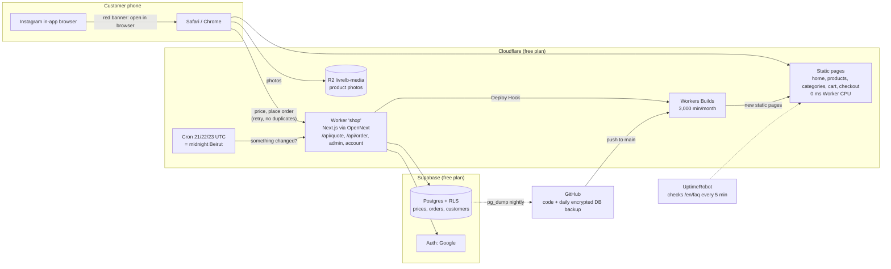
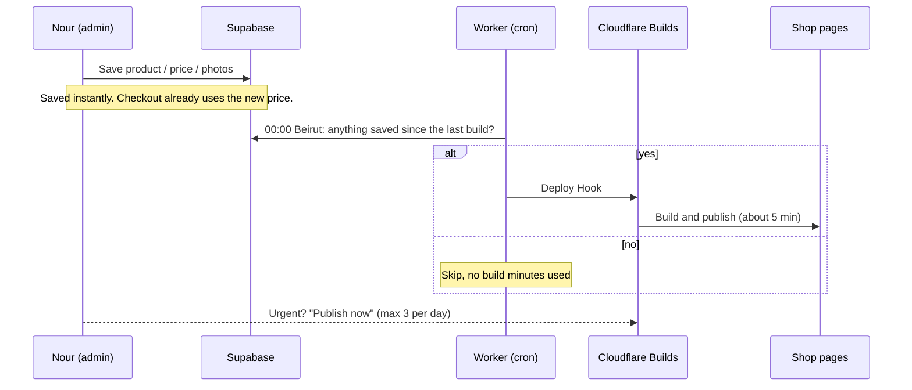

# LIVRE — personalized jewelry from Lebanon

**Live shop:** <https://shop.livrelb.workers.dev> · **Admin:** `/admin`

LIVRE ("1 Livre", the old Lebanese 1-Lira coin) is the online store of
**Mrshop Nour**: personalized name jewelry, the Lebanese Lira collection,
charms, gifts and gift boxes. Customers type a name and see it live on the
piece before they buy. The whole shop runs on **free plans**.

This README tells two stories: what the shop does and how it is built, and
how it was made: the problems we hit, the free solutions we found, and the
way one developer in Lebanon shipped a real store with AI as his team.

---

## Contents

1. [Why this project exists](#why-this-project-exists)
2. [Three hats: owner, developer, builder in Lebanon](#three-hats-owner-developer-builder-in-lebanon)
3. [What the shop does](#what-the-shop-does)
4. [Architecture](#architecture)
5. [Stack and services](#stack-and-services)
6. [Running a real shop for $0](#running-a-real-shop-for-0)
7. [Problems we hit and how we solved them](#problems-we-hit-and-how-we-solved-them)
8. [How I worked with AI](#how-i-worked-with-ai)
9. [Operating the shop](#operating-the-shop)
10. [Run it locally](#run-it-locally)
11. [Roadmap](#roadmap)
12. [Lessons for the next project](#lessons-for-the-next-project)

---

## Why this project exists

Before LIVRE, the business ran on **five separate Instagram pages**, each
handled by one employee with her own phone. Customers got lost between pages,
orders lived in chats, nothing was saved, and the owner could not see who sold
what.

LIVRE replaces that with **one store** that:

- saves every customer and every order in a real database,
- still credits each order to the employee who brought the customer,
- lets the owner run prices, products, delivery and the homepage from an
  admin panel on her phone,
- keeps a strong Lebanese identity: the cedar, the 1975 Lira coin, made in
  Lebanon.

## Three hats: owner, developer, builder in Lebanon

I'm **Moemen**, Nour's brother. I built this shop wearing three hats at once.

**As the business side.** I know how this shop works day to day: most
customers arrive from Instagram on a phone, they want to see their name on
the necklace before paying, they pay cash on delivery or by Whish, and the
team answers on WhatsApp. Every decision was checked against one question:
*does this help Nour sell, or does it get in her way?* That's why the admin
is mobile first, why changes publish on their own at night, and why a gift
box doesn't ask for a metal or a chain length.

**As a senior developer.** I treated it as a production system, not a demo:
row level security on every table, prices always computed on the server,
orders that can't be duplicated by a retry, daily encrypted backups, a
rollback path, branches for every change, and checks (lint, types, build,
screenshots at 375px and 1440px) before anything goes live.

**As someone building in Lebanon today.** Budgets are tight, payments in
dollars are hard, and "just pay for the Pro plan" is not always an answer.
So the rule for the first months was **zero monthly cost**. The original plan
assumed about $45/month (Vercel Pro + Supabase Pro). The shop runs today for
**$0**, and every limit we hit was solved with a free tool. AI made it
possible for one person to do the work of a small team: write code, review
it, test it, and explain every trade-off in my own language.

## What the shop does

### For customers

- **Live name preview**: type a name, pick the font and metal, see it drawn
  on the piece.
- **3D Lira coin** on the homepage (React Three Fiber), lazy-loaded and paused
  when off-screen.
- Categories, seasons, charms, best sellers, reviews, size guide, FAQ, order
  tracking.
- **Flexible products**: jewelry asks for metal, size, connection and name;
  a simple product (gift box, bouquet) shows only photos, old price and price.
  Products can have their own colors.
- **Sign in with Google** at checkout; saved details prefill the next order.
- **Cash on delivery or Whish**, first order with free delivery, free
  delivery over a threshold.
- **Instagram / Facebook in-app browsers**: a red banner explains how to open
  the shop in Safari or Chrome (Google blocks sign-in inside those apps), and
  the bag can travel to the real browser.

### For the owner and staff (`/admin`)

- Dashboard: today, this week, this month.
- Orders, customers, products, charms, reviews, delivery zones, seasons,
  homepage cards, settings, sales summary, activity log.
- **Staff and attribution**: each employee has a personal link (`?ref=code`);
  the order is credited to her.
- Per-employee permissions.
- **Publishing**: saves go to the database; the shop updates **every night at
  00:00 Beirut time**, or right away with **"Publish now"** (3 per day).
- Photos are resized in the browser (WebP, 1200px and 600px) and uploaded
  straight to storage.
- Push notifications for new orders.

## Architecture



**The key idea:** customers mostly read pages, and reading should cost
nothing. So the store pages are built once and served as static files. The
Worker only runs for what must be live: prices, placing an order, the admin
and the customer account.

### How a change reaches the shop



## Stack and services

| Layer | Choice | Link |
| --- | --- | --- |
| Framework | Next.js 16 (App Router, TypeScript), React 19 | <https://nextjs.org> |
| Styling | Tailwind CSS 4 | <https://tailwindcss.com> |
| 3D | Three.js, React Three Fiber, drei | <https://r3f.docs.pmnd.rs> |
| i18n | next-intl (English today, Arabic RTL ready) | <https://next-intl.dev> |
| Database, auth | Supabase (Postgres, Row Level Security, Google sign-in) | <https://supabase.com> |
| Hosting | Cloudflare Workers + static assets, via OpenNext | <https://developers.cloudflare.com/workers/> · <https://opennext.js.org/cloudflare> |
| Builds | Cloudflare Workers Builds + Deploy Hooks | <https://developers.cloudflare.com/workers/ci-cd/builds/> |
| Scheduler | Cloudflare Cron Triggers | <https://developers.cloudflare.com/workers/configuration/cron-triggers/> |
| Photos | Cloudflare R2 (signed uploads) | <https://developers.cloudflare.com/r2/> |
| Page cache | Cloudflare R2 + D1 + Durable Objects (OpenNext cache) | <https://developers.cloudflare.com/d1/> |
| Backups | GitHub Actions + Supabase CLI + gpg | <https://docs.github.com/actions> |
| Monitoring | UptimeRobot (free) | <https://uptimerobot.com> |
| Code | GitHub | <https://github.com/Moemenakari/livrelb> |
| AI | Claude (in Antigravity, and Claude Code) | <https://claude.com/claude-code> |

## Running a real shop for $0

| | Original plan | What runs today |
| --- | --- | --- |
| Hosting | Vercel Pro, ~$20/month | Cloudflare Workers free plan |
| Database | Supabase Pro, ~$25/month | Supabase free plan |
| Backups | Included in Supabase Pro | GitHub Actions, daily, encrypted, kept 14 days |
| Monitoring | none | UptimeRobot free |
| **Total** | **~$45/month** | **$0/month** |

Free limits we designed around:

| Limit | Value | How we stay inside it |
| --- | --- | --- |
| Worker CPU per request | 10 ms | Store pages are static files; only small API calls hit the Worker |
| Worker requests | 100,000 per day | Static pages and photos don't count; link prefetch is off |
| Build minutes | 3,000 per month | One build per night only if something changed, plus up to 3 "Publish now" a day (~200 min/month expected) |
| R2 storage | 10 GB, 1M writes, 10M reads per month | Photos compressed to WebP in the browser before upload |
| Supabase | 500 MB database, no backups | ~15 MB used; our own nightly backup |

## Problems we hit and how we solved them

Every fix below is free.

| # | Problem | Root cause | Solution |
| --- | --- | --- | --- |
| 1 | Random **error 1102** pages, even with one visitor | Next.js needs 55–160 ms of CPU per page; the free Worker allows 10 ms | Store pages prerendered and served as **static assets** (0 CPU). Link prefetch off (48 → 1 Worker requests on a full homepage scroll). UptimeRobot keeps the Worker warm |
| 2 | Checkout could fail on a busy moment | Checkout still runs on the Worker | Checkout page is static; "Place order" **retries** on 503/1102 with the same `requestId`, so a retry can never create a second order. The bag and typed fields are never lost |
| 3 | Admin edits would burn the monthly build minutes | Every save triggered a 4–6 minute build | **Nightly publish at 00:00 Beirut** (handles summer/winter time) only when something changed, plus **"Publish now"** limited to 3 a day |
| 4 | Google sign-in **impossible inside Instagram** | Google blocks OAuth in in-app browsers | Detect in-app browsers, allow adding to the bag without login there, a **red banner** with "⋯ → Open in external browser", and a `?bag=` link that carries the bag (re-priced from the database, never trusted) |
| 5 | Home-screen app treated as Instagram | iOS removes "Safari" from the user agent of installed web apps | Treat standalone mode as a normal browser |
| 6 | Product photos would bring 1102 back | Every image went through `/_next/image` on the Worker | Resize in the browser (WebP 1200px + 600px), signed upload straight to **R2**, served from R2 without the Worker |
| 7 | A gift box was asked for a metal and a chain size | Every product had every jewelry option | Per-product **show/hide switches** (metal/color, size, connection, name), custom colors, a neutral "Standard" price row. Additive migration with a self-check that compared **611 prices** before/after and rolls back on any difference |
| 8 | The daily backup had **never run** | Secrets missing, then a wrong database password | Added `SUPABASE_DB_URL` (Session pooler URL) and `BACKUP_PASSPHRASE`; the backup is green every night |
| 9 | Broken links in the sitemap and some photos | Environment variables saved with a hidden newline | `.trim()` in code, and the variables retyped in Cloudflare Build settings |
| 10 | The 3D coin blocked taps on the banner | The coin layer sat above the banner | Fixed the stacking order |
| 11 | Two AI sessions edited the same files | Two chats on one working tree | Rule: one session makes changes, the other only reviews |
| 12 | A deploy to `main` was blocked by the AI's safety check | "Accept all" wasn't a clear permission to publish | Explicit phrase for production: **"ادمج وانشر"** (merge and deploy) |

## How I worked with AI

**The team:** one human and two Claude sessions.

- **Claude inside Antigravity** (on my computer) was the builder: it wrote the
  code, ran the checks, took the screenshots and deployed.
- **Claude Code** (in the cloud) was my reviewer and advisor: it read every
  report, found what the builder missed (the backup that never ran, the build
  minutes, the photos, the checkout), translated reports into plain Lebanese
  Arabic, and wrote the next prompt.

**The rules that made it work:**

- I talk in Lebanese Arabic; code, commits and files stay in English.
- **Read-only audit first, fixes second.** Every big step started with a
  report ranked 🔴 / 🟡 / 🟢 and waited for my approval.
- Anything sensitive (live database, deleting, pushing to `main`) is
  explained in 2–3 lines and waits for my "موافق".
- Work on a **branch**, small commits, then merge.
- Before any database change: **run the backup**, test the migration inside a
  transaction that rolls back, then apply.
- Every visual change is checked at **375px and 1440px**; design, prices and
  the 3D coin are mine to decide.
- **Nothing paid** until the shop earns it.
- Secrets never go in the chat: I paste them into Cloudflare and GitHub
  myself.
- A codebase graph (`graphify-out/GRAPH_REPORT.md`) helps the AI find the
  right files fast.

The prompts for each phase are kept in [docs/prompts/](docs/prompts/), and
the master spec in [PROJECT_BRIEF.md](PROJECT_BRIEF.md).

## Operating the shop

| Task | How |
| --- | --- |
| Daily work (for Nour) | [docs/GUIDE_AR.md](docs/GUIDE_AR.md), in simple Lebanese Arabic |
| Publish | Automatic at 00:00 Beirut, or **Publish now** in the admin (3/day) |
| Backups | GitHub → Actions → **Database backup**, daily at 01:15 UTC; restore steps in [docs/database.md](docs/database.md#database-backups) |
| Rollback | Cloudflare → Workers & Pages → `shop` → **Deployments** → ⋯ → **Rollback**. Database changes are additive, so old code keeps working |
| Monitoring | UptimeRobot on `/en/faq`; Cloudflare → `shop` → **Metrics** for errors and CPU |
| Hosting setup | [docs/hosting.md](docs/hosting.md), [docs/LAUNCH_AR.md](docs/LAUNCH_AR.md) |
| Database | [docs/database.md](docs/database.md) |

Secrets live only in `.env.local`, Cloudflare (Variables and Secrets) and
GitHub (Actions secrets). Never in code or in a chat.

## Run it locally

Requirements: **Node.js 20.9 or newer** and npm.

```bash
npm install
cp .env.example .env.local      # PowerShell: Copy-Item .env.example .env.local
npm run dev
```

Open <http://localhost:3000> (it redirects to `/en`).

With `NEXT_PUBLIC_SUPABASE_URL` and `NEXT_PUBLIC_SUPABASE_PUBLISHABLE_KEY` in
`.env.local`, the store reads the catalog from Supabase; without them it uses
the sample catalog in `src/lib/catalog/`, so it always runs.
<http://localhost:3000/api/health> shows which one is used.

| Command | What it does |
| --- | --- |
| `npm run dev` | Dev server on port 3000 |
| `npm run build` | Production build + check that store pages stay static |
| `npm run lint` | ESLint (also blocks hardcoded text in JSX) |
| `npm run typecheck` | TypeScript check |
| `npm run i18n:check` | Checks `messages/en.json` |
| `npm run preview` | Cloudflare build, run locally in the Workers runtime |
| `npm run deploy` | Cloudflare build and deploy (normally Cloudflare builds on push to `main`) |
| `npm run db:seed:generate` | Rewrites `supabase/seed.sql` from the sample catalog |
| `npm run db:create-owner` | Creates the owner's login (needs `SUPABASE_SECRET_KEY`) |

### Where things live

```text
src/app/[locale]/          Store pages (home, category, product, cart, checkout, track...)
src/app/admin/             Admin panel
src/app/api/               Worker routes: quote, order, bag, checkout-init, push, health...
src/components/coin/       3D Lira coin and its scroll path
src/components/preview/    Live name preview
src/lib/catalog/           getCatalog() and the sample catalog
src/lib/publish/           Nightly publish rules and "Publish now"
src/lib/storage/r2.ts      Signed uploads to R2
src/lib/open-in-browser.ts In-app browser detection and bag hand-off
scripts/static-pages.mjs   Turns built pages into static assets
worker.mjs, publish-due.mjs  Worker entry and the nightly check
supabase/migrations/       Schema, RLS, functions
messages/en.json           All UI text
.github/workflows/         Daily encrypted database backup
```

### Rules of the codebase

- **No hardcoded text**: every string goes in `messages/en.json`.
- **RTL-ready**: use logical Tailwind classes (`ms-*`, `pe-*`, `start-*`,
  `text-start`), not left/right.
- **Light boutique theme**: colors and fonts come from the tokens in
  `globals.css`.
- **The homepage coin** sits in a fixed layer; section content must be
  `relative z-[1]`.
- **Store pages must stay static**: `npm run build` fails if one becomes
  dynamic.
- Check every screen at **375px** before calling it done.

## Roadmap

- [ ] Domain **livrelb.com**, then `images.livrelb.com` for photos (r2.dev is
      rate-limited and meant for development) and free cache rules.
- [ ] "X sold" and "#1 Best Seller" from a database function.
- [ ] Arabic version (RTL is already supported in the code).
- [ ] Card and Whish online payments.
- [ ] WhatsApp OTP for phone verification.
- [ ] Paid plans only when the shop pays for them.

## Lessons for the next project

1. **Design approval before code.** Changing a picture takes a minute;
   changing built code breaks other things.
2. **Two databases from day one:** `dev` for experiments, `prod` untouched
   until launch.
3. **Work locally, share preview links**, publish once the client says yes.
4. **Squash migrations before launch** into one clean migration.
5. **Know your free limits before choosing the architecture.** Static first,
   server only where it must be.
6. **Backups are only real once you've seen a green run.**
7. **One AI session changes code; another reviews it.**

---

Built in Lebanon by **Moemen** for **Mrshop Nour**. 🇱🇧
