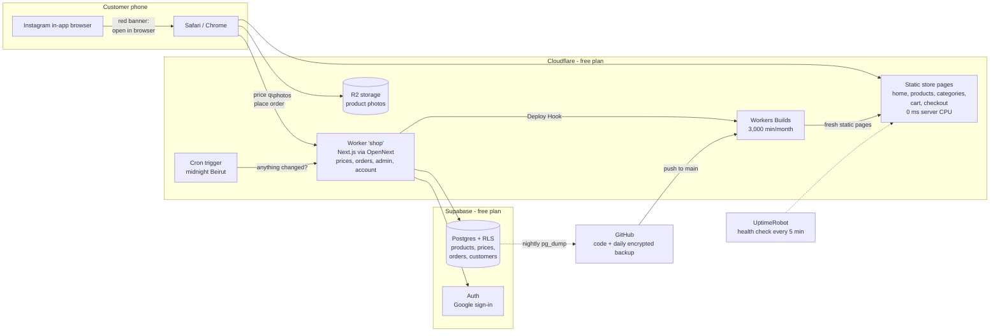
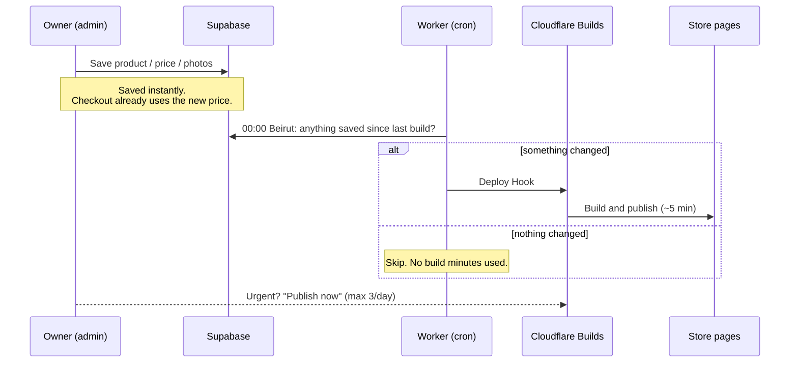
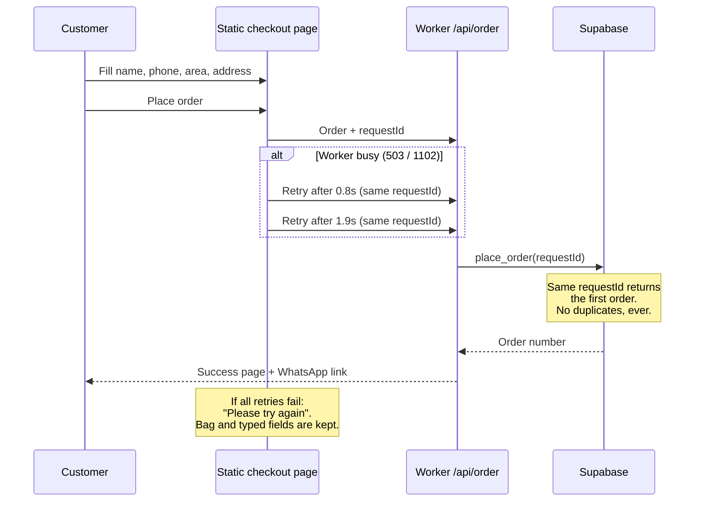
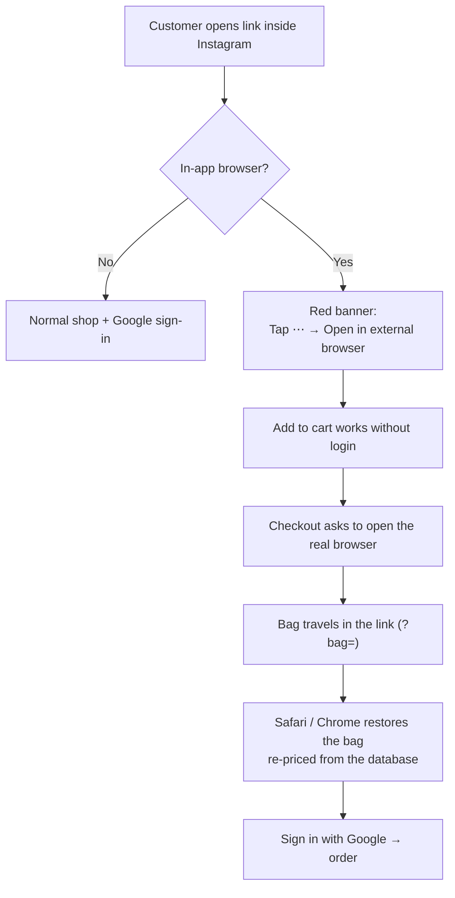
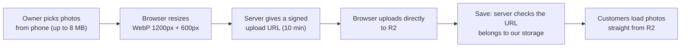
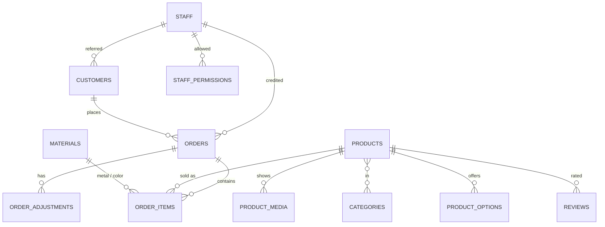
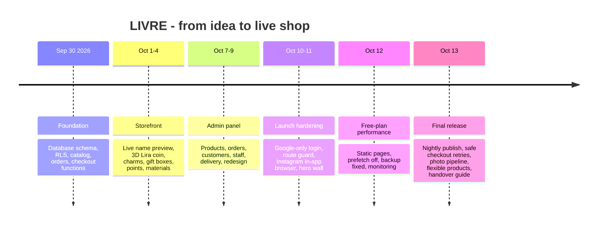

# LIVRE — Personalized Jewelry from Lebanon

**Live shop:** https://shop.livrelb.workers.dev  
**Admin panel:** https://shop.livrelb.workers.dev/admin  
**Built by:** Moemen — for **Mrshop Nour**  
**Status:** Live · Running on **$0/month**

LIVRE ("1 Livre", the old Lebanese 1-Lira coin) is a full e-commerce platform for a Lebanese jewelry business: personalized name necklaces, the Lebanese Lira collection, charms, gifts and gift boxes. Customers type a name and watch it appear live on the piece before they buy.

I designed, built, debugged and launched this platform end to end: product, architecture, database, frontend, backend, hosting, security, backups, monitoring and the handover to the business. This README is the full story of how I did it, what I used, what went wrong, and how I fixed it, all on free plans, from Lebanon.

---

## Table of contents

1. [The business problem](#1-the-business-problem)
2. [My three perspectives](#2-my-three-perspectives)
3. [What the platform does](#3-what-the-platform-does)
4. [System architecture](#4-system-architecture)
5. [Key flows (diagrams)](#5-key-flows-diagrams)
6. [Database design](#6-database-design)
7. [Tech stack and every tool I used](#7-tech-stack-and-every-tool-i-used)
8. [Skills I applied](#8-skills-i-applied)
9. [Running a real shop for $0](#9-running-a-real-shop-for-0)
10. [Problems I faced and how I solved them](#10-problems-i-faced-and-how-i-solved-them)
11. [Mistakes I made and what I learned](#11-mistakes-i-made-and-what-i-learned)
12. [How I worked: AI-assisted engineering](#12-how-i-worked-ai-assisted-engineering)
13. [Project timeline](#13-project-timeline)
14. [Results in numbers](#14-results-in-numbers)
15. [Operating the shop](#15-operating-the-shop)
16. [Run it locally](#16-run-it-locally)
17. [Roadmap](#17-roadmap)
18. [Lessons for my next project](#18-lessons-for-my-next-project)

---

## 1. The business problem

Before LIVRE, the business ran on **five separate Instagram pages**. Each page was handled by one employee with her own phone number.

- Customers got lost between pages.
- Orders lived inside chats and were never saved.
- The owner could not see who sold what.
- There was no customer history, no sales summary, no real catalog.

**The goal:** one store that replaces the chaos, without slowing down the sale:

- every customer and every order saved in a real database,
- every order still credited to the employee who brought the customer,
- the owner controls products, prices, delivery and the homepage from her phone,
- a strong Lebanese identity: the cedar, the 1975 Lira coin, made in Lebanon.

---

## 2. My three perspectives

I'm Moemen, Nour's brother. I built LIVRE wearing three hats at the same time, and every decision had to satisfy all three.

### As the business side

I know how this shop works every day:

- Almost every customer comes from **Instagram, on a phone**.
- She wants to **see her name on the necklace** before paying.
- She pays **cash on delivery or by Whish**.
- The team answers on **WhatsApp**.
- Nour is not a programmer. The admin must be simple, mobile first, and hard to break.

So my test for every feature was: **does this help Nour sell, or does it get in her way?** That's why a gift box doesn't ask for a metal or a chain length, why changes publish on their own at midnight, and why the checkout never shows an error page.

### As a senior developer

I treated it as a production system, not a demo:

- Row Level Security on every table.
- Prices always computed on the server, never trusted from the browser.
- Orders that can never be duplicated by a retry.
- Daily encrypted backups, tested.
- A one-click rollback path.
- Branches for every change, checks before every merge.
- Every screen verified at 375px (phone) and 1440px (desktop).

### As a builder in Lebanon

Budgets are tight and paying in dollars is hard. "Just upgrade to Pro" is not always an option. So I set a hard rule: **zero monthly cost until the shop pays for itself**.

The original plan assumed about **$45/month** (Vercel Pro + Supabase Pro). The shop runs today for **$0**. Every limit I hit, I solved with a free tool or a better architecture. AI tools let me work at the speed of a small team while I stayed the architect, the reviewer and the decision maker.

---

## 3. What the platform does

### Customer side

| Feature | Details |
| --- | --- |
| Live name preview | Type a name, pick font and metal, see it drawn on the piece instantly |
| 3D Lira coin | Real-time 3D model of the 1975 Lebanese Lira on the homepage (Three.js), lazy-loaded, pauses off-screen |
| Catalog | Categories, seasons, charms, best sellers, new arrivals, reviews, size guide, FAQ |
| Flexible products | Jewelry asks for metal, size, connection and name. Simple products (gift box, bouquet) show only photos, old price and price. Custom colors per product |
| Accounts | Sign in with Google; saved name, phone and address prefill the next checkout |
| Checkout | Cash on delivery or Whish; free delivery on first order and above a threshold |
| Order tracking | Track page with order status |
| Instagram support | Detects in-app browsers, shows a red banner explaining how to open in Safari/Chrome, and carries the bag across |
| Staff attribution | Personal links (`?ref=code`) credit the order to the employee |

### Admin side (`/admin`)

| Area | What the owner can do |
| --- | --- |
| Dashboard | Orders and sales today, this week, this month |
| Orders | View, update status, adjust, delete test orders |
| Products | Add/edit products, photos and video, prices, old prices, show/hide options per product |
| Charms, reviews, seasons | Manage collections and seasonal pages |
| Delivery | Zones and fees |
| Homepage | Cards behind the 3D coin, announcements |
| Staff | Employees, personal codes, permissions |
| Sales summary | Simple numbers, no accounting |
| Activity log | Who changed what |
| Publishing | Changes go live automatically at **00:00 Beirut**, or instantly with **Publish now** (3 per day) |
| Notifications | Push notifications for new orders |

---

## 4. System architecture



**The core idea:** customers mostly *read* pages, and reading should cost nothing. So I prerender the store pages and serve them as static files from Cloudflare's network. The server (Worker) only runs for what must be live: prices, placing an order, the admin, and customer accounts.

---

## 5. Key flows (diagrams)

### 5.1 How an admin change reaches the shop



### 5.2 Placing an order safely



### 5.3 Instagram in-app browser



### 5.4 Product photo upload



---

## 6. Database design

PostgreSQL on Supabase, **37 tables**, Row Level Security on every one, managed through versioned migrations.



Design decisions:

- **Prices live in database functions** (`price_item`, `place_order`, `quote_order`). The browser never decides a price.
- **Attribution priority** on each order: personal code > checkout field > customer's saved employee > ref cookie.
- **Audit log** records who changed what; the nightly publish reads it to know if anything changed.
- **Flexible products**: four switch columns (`ask_material`, `ask_size`, `ask_connection`, `ask_personalization`) plus a neutral "Standard" price row for simple products.
- **Only additive migrations** after launch, so old code keeps working and rollback stays clean.

---

## 7. Tech stack and every tool I used

### Application

| Tool | What I used it for |
| --- | --- |
| [Next.js 16](https://nextjs.org) (App Router) | The whole app: store, admin, API routes |
| [React 19](https://react.dev) | UI |
| [TypeScript](https://www.typescriptlang.org) | Type safety everywhere |
| [Tailwind CSS 4](https://tailwindcss.com) | Design system with brand tokens |
| [Three.js](https://threejs.org), [React Three Fiber](https://r3f.docs.pmnd.rs), [drei](https://github.com/pmndrs/drei) | The 3D Lira coin |
| [next-intl](https://next-intl.dev) | Translations, RTL-ready for Arabic |
| [lucide-react](https://lucide.dev) | Icons |
| [aws4fetch](https://github.com/mhart/aws4fetch) | Signed uploads to R2 |
| [read-excel-file](https://www.npmjs.com/package/read-excel-file) | Importing old orders from Excel |

### Data and auth

| Tool | What I used it for |
| --- | --- |
| [Supabase](https://supabase.com) Postgres | Database, functions, Row Level Security |
| Supabase Auth | Google sign-in for customers, staff login |
| [Supabase CLI](https://supabase.com/docs/guides/cli) | Migrations, database dumps |
| Google OAuth | "Continue with Google" |

### Hosting and infrastructure (Cloudflare)

| Tool | What I used it for |
| --- | --- |
| [Cloudflare Workers](https://developers.cloudflare.com/workers/) | Server code |
| [OpenNext for Cloudflare](https://opennext.js.org/cloudflare) | Running Next.js on Workers |
| Workers static assets | Serving prerendered pages with zero server CPU |
| [Workers Builds](https://developers.cloudflare.com/workers/ci-cd/builds/) | Build and deploy on every push to `main` |
| Deploy Hooks | "Publish now" and nightly publish |
| [Cron Triggers](https://developers.cloudflare.com/workers/configuration/cron-triggers/) | The midnight Beirut check |
| [R2](https://developers.cloudflare.com/r2/) | Product photos and page cache |
| [D1](https://developers.cloudflare.com/d1/) | Cache tags |
| Durable Objects | Background page revalidation queue |
| Cloudflare Images binding | Image resizing |

### DevOps, quality and monitoring

| Tool | What I used it for |
| --- | --- |
| [GitHub](https://github.com) | Code, branches, pull requests |
| [GitHub Actions](https://docs.github.com/actions) | Daily encrypted database backup |
| gpg | Encrypting backups (they contain customer phones and addresses) |
| [UptimeRobot](https://uptimerobot.com) | Uptime monitoring and email alerts |
| ESLint | Linting, plus a custom rule that blocks hardcoded text |
| `tsc` | Type checking |
| Custom build guard | Fails the build if a store page stops being static |
| [Lighthouse](https://developer.chrome.com/docs/lighthouse) | Performance, accessibility, SEO audits |
| Headless browser | Screenshots at 375px and 1440px for every change |
| Web Push (VAPID) | Order notifications for the team |

### Development environment

| Tool | What I used it for |
| --- | --- |
| [Antigravity](https://antigravity.google) IDE | Main development environment |
| AI coding assistants | Code generation, audits and reviews, under my direction (see section 12) |
| Codebase graph (graphify) | Mapping the codebase so the right files are found fast |

---

## 8. Skills I applied

**Engineering**

- **System architecture**: static-first design so a free plan can carry a real shop.
- **Database design**: 37 tables, RLS policies, SQL functions for pricing and orders, idempotent order placement.
- **Migrations and data safety**: additive migrations, transactional dry-runs, a self-check that compared 611 prices before and after.
- **Performance engineering**: CPU profiling per route, cutting Worker requests from 48 to 1 per page scroll, JS bundles 70–80 KB smaller per page.
- **Cloud and DevOps**: Cloudflare Workers, R2, D1, cron, deploy hooks, CI/CD, rollback.
- **Security**: server-side pricing, signed uploads, secrets management, encrypted backups, RLS everywhere.
- **Reliability**: retries with idempotency keys, monitoring, warm-up checks, daily backups.
- **Frontend**: responsive mobile-first UI, 3D graphics, live preview, accessibility (100 on product, cart and checkout in local Lighthouse runs).
- **Debugging from evidence**: reading Cloudflare metrics, GitHub Actions logs and Supabase logs to find root causes instead of guessing.

**Product and business**

- **Product thinking**: designing around how Lebanese customers actually buy (Instagram, phone, cash on delivery, WhatsApp).
- **Cost engineering**: turning a ~$45/month plan into $0.
- **Requirements and trade-offs**: choosing midnight publishing over instant updates to stay inside free build minutes.
- **Handover**: an Arabic guide for a non-technical owner.

**AI-era skills**

- **Prompt engineering**: precise, rule-bound prompts with approval gates.
- **AI orchestration**: one assistant builds, another audits; I decide.
- **Review discipline**: never accepting AI output without checks, screenshots and my own reading of the trade-offs.

---

## 9. Running a real shop for $0

| | Original plan | What runs today |
| --- | --- | --- |
| Hosting | Vercel Pro, ~$20/month | Cloudflare Workers free plan |
| Database | Supabase Pro, ~$25/month | Supabase free plan |
| Backups | Included in Supabase Pro | GitHub Actions, daily, encrypted, kept 14 days |
| Monitoring | none | UptimeRobot free |
| **Total** | **~$45/month** | **$0/month** |

Free limits I designed around:

| Limit | Value | How I stay inside it |
| --- | --- | --- |
| Worker CPU per request | 10 ms | Store pages are static files; only small API calls reach the Worker |
| Worker requests | 100,000/day | Static pages and photos don't count; link prefetch disabled |
| Build minutes | 3,000/month | One build per night only if something changed + max 3 "Publish now" a day (~200 min/month expected) |
| R2 storage | 10 GB, 1M writes, 10M reads/month | Photos compressed to WebP in the browser before upload |
| Supabase database | 500 MB, no backups | ~15 MB used; my own nightly backup |

---

## 10. Problems I faced and how I solved them

Every solution below is free.

| # | Problem | Root cause | My solution |
| --- | --- | --- | --- |
| 1 | Random **error 1102** pages, even with one visitor (~17% of requests in a test) | Next.js needs 55–160 ms CPU per page; the free Worker allows 10 ms | Prerendered store pages served as **static assets** (0 CPU). Disabled link prefetch (48 → 1 Worker requests per homepage scroll). UptimeRobot keeps the Worker warm |
| 2 | Checkout could fail in a busy moment | Checkout still needs the server | Static checkout page; "Place order" **retries** on 503/1102 with the same `requestId`, so a retry can never create a second order. The bag and typed fields are never lost |
| 3 | Admin edits would burn the monthly build minutes | Every save would trigger a 4–6 minute build | **Nightly publish at 00:00 Beirut** (handles summer/winter time) only when something changed, plus **Publish now** limited to 3/day |
| 4 | **Google sign-in impossible inside Instagram** | Google blocks OAuth in in-app browsers | Detect in-app browsers; allow add-to-bag without login; **red banner** with "⋯ → Open in external browser"; `?bag=` link carries the bag, re-priced from the database |
| 5 | "Open in Safari" button didn't work on iPhone Instagram | `x-safari-https://` is blocked in some Instagram versions | Made the manual path (⋯ menu) the main instruction, in red; button relabeled "Open in external browser" to match the menu |
| 6 | Home-screen app treated as Instagram | iOS removes "Safari" from the user agent of installed web apps | Standalone mode treated as a normal browser |
| 7 | Product photos would bring 1102 back | Every image went through `/_next/image` on the Worker | Resize in the browser (WebP 1200px + 600px), signed upload straight to **R2**, served without the Worker |
| 8 | A gift box was asked for a metal and a chain size | Every product had every jewelry option | Per-product **show/hide switches**, custom colors, neutral "Standard" price row. Additive migration with a self-check comparing **611 prices**, rolling back on any difference |
| 9 | The daily backup had **never run** | Secrets missing, then a wrong database password | Added `SUPABASE_DB_URL` (Session pooler) and `BACKUP_PASSPHRASE`; verified a green run before any database change |
| 10 | Broken sitemap links and some photo URLs | Environment variables saved with a hidden newline | `.trim()` in code and retyped the build variables in Cloudflare |
| 11 | The 3D coin blocked taps on the banner | Coin layer stacked above the banner | Fixed the stacking order |
| 12 | Conflicting edits on the same files | Two development sessions working on one tree at once | One session makes changes; the other only reviews |
| 13 | A production deploy was blocked by a safety check | An approval like "accept all" wasn't explicit enough for production | A clear, explicit phrase is required before any merge-and-deploy to `main` |

---

## 11. Mistakes I made and what I learned

I'm writing these honestly, because they taught me the most.

| Mistake | Consequence | What I do now |
| --- | --- | --- |
| Worked on the **live database** from day one | Many small migrations piled up; every experiment touched production | Separate `dev` and `prod` databases from the start |
| Didn't check **free-plan limits** before choosing the architecture | Error 1102 appeared after launch | Read the limits first, design static-first |
| Assumed the backup worked because the workflow existed | It had failed every single day | A backup is real only after a green run I've seen |
| Assumed Google sign-in works everywhere | Instagram customers couldn't log in | Test on real devices, inside real apps |
| Shared a secret in a chat during setup | Had to rotate it | Secrets go only into Cloudflare, GitHub or `.env.local` |
| Ran heavy tests against the live site | Short outage during testing | Small, read-only checks on production; load tests only on previews |
| Ran two sessions on one codebase | Overlapping edits | One writer at a time |
| Approved too broadly ("accept all") | Ambiguous permission for production | Explicit approvals for anything live |

---

## 12. How I worked: AI-assisted engineering

I used AI coding assistants as tools, the way a lead developer uses a team. I owned the product, the architecture, the decisions and the quality bar; the assistants executed under rules I set.

**My setup**

- A **builder** environment (Antigravity IDE) that writes code, runs checks, takes screenshots and deploys, only after my approval.
- A **reviewer** session that audits every report, catches what the builder missed, and turns findings into the next precise instruction.

Examples of issues caught in review: the backup that never ran, the build-minute risk, the photo path through the Worker, the checkout still running on the server, and the product options forced on gift boxes.

**My rules**

1. **Audit first, fix second.** Every big step starts with a read-only report ranked 🔴 must fix / 🟡 good to fix / 🟢 fine, and waits for my approval.
2. **Sensitive actions need my explicit OK**: live database, deleting data, pushing to `main`.
3. **Branches and small commits**, one topic each.
4. **Before any database change**: run the backup, test the migration in a transaction that rolls back, then apply.
5. **Every visual change** verified at 375px and 1440px. Design, prices and the 3D coin are my decisions only.
6. **Nothing paid** until the shop earns it.
7. **Secrets never in prompts or chats.**
8. Communication in my language (Lebanese Arabic); code, commits and docs in English.

The phase-by-phase specifications live in [docs/prompts/](docs/prompts/) and the master spec in [PROJECT_BRIEF.md](PROJECT_BRIEF.md).

---

## 13. Project timeline



---

## 14. Results in numbers

| Metric | Result |
| --- | --- |
| Monthly cost | **$0** (planned ~$45) |
| Worker requests per homepage scroll | **48 → 1** |
| Store page server CPU | **55–85 ms → 0 ms** (static) |
| Price-quote route CPU | **~680 ms → ~280 ms** |
| JavaScript per page | **70–80 KB smaller** |
| Lighthouse Performance (local) | Product 70 → 80 · Cart 79 → 84 · Checkout 68 → 84 |
| Lighthouse Accessibility | 100 on product, cart, checkout |
| SEO | 92 → 100 on public pages |
| Tables with RLS | 37 / 37 |
| Prices verified during the last migration | 611, all identical |
| Duplicate orders possible on retry | 0 |
| Database backups | Daily, encrypted, 14 days |
| Expected build minutes | ~200 / 3,000 per month |

---

## 15. Operating the shop

| Task | How |
| --- | --- |
| Daily work (owner) | [docs/GUIDE_AR.md](docs/GUIDE_AR.md), in simple Lebanese Arabic |
| Publishing | Automatic at 00:00 Beirut, or **Publish now** in the admin (3/day) |
| Backups | GitHub → Actions → **Database backup**, daily; restore steps in [docs/database.md](docs/database.md#database-backups) |
| Rollback | Cloudflare → Workers & Pages → `shop` → **Deployments** → ⋯ → **Rollback**. Migrations are additive, so old code keeps working |
| Monitoring | UptimeRobot on `/en/faq`; Cloudflare → `shop` → **Metrics** |
| Hosting setup | [docs/hosting.md](docs/hosting.md), [docs/LAUNCH_AR.md](docs/LAUNCH_AR.md) |
| Database reference | [docs/database.md](docs/database.md) |

Secrets live only in `.env.local`, Cloudflare (Variables and Secrets) and GitHub (Actions secrets). Never in code.

---

## 16. Run it locally

Requirements: **Node.js 20.9+** and npm.

```bash
npm install
cp .env.example .env.local      # PowerShell: Copy-Item .env.example .env.local
npm run dev
```

Open http://localhost:3000 (redirects to `/en`).

With `NEXT_PUBLIC_SUPABASE_URL` and `NEXT_PUBLIC_SUPABASE_PUBLISHABLE_KEY` in `.env.local`, the store reads the catalog from Supabase. Without them it uses the sample catalog in `src/lib/catalog/`, so it always runs. http://localhost:3000/api/health shows which one is used.

| Command | What it does |
| --- | --- |
| `npm run dev` | Dev server on port 3000 |
| `npm run build` | Production build + guard that store pages stay static |
| `npm run lint` | ESLint (also blocks hardcoded text in JSX) |
| `npm run typecheck` | TypeScript check |
| `npm run i18n:check` | Validates `messages/en.json` |
| `npm run preview` | Cloudflare build, run locally in the Workers runtime |
| `npm run deploy` | Cloudflare build and deploy (normally automatic on push to `main`) |
| `npm run db:seed:generate` | Rewrites `supabase/seed.sql` from the sample catalog |
| `npm run db:create-owner` | Creates the owner's login |

### Project structure

```text
src/app/[locale]/            Store pages (home, category, product, cart, checkout, track...)
src/app/admin/               Admin panel
src/app/api/                 Server routes: quote, order, bag, checkout-init, push, health
src/components/coin/         3D Lira coin and its scroll path
src/components/preview/      Live name preview
src/lib/catalog/             getCatalog() and the sample catalog
src/lib/publish/             Nightly publish rules and "Publish now"
src/lib/storage/r2.ts        Signed uploads to R2
src/lib/open-in-browser.ts   In-app browser detection and bag hand-off
scripts/static-pages.mjs     Turns built pages into static assets
worker.mjs, publish-due.mjs  Worker entry and the nightly check
supabase/migrations/         Schema, RLS, functions
messages/en.json             All UI text
.github/workflows/           Daily encrypted database backup
```

### Codebase rules

- **No hardcoded text**: every string lives in `messages/en.json`.
- **RTL-ready**: logical Tailwind classes (`ms-*`, `pe-*`, `start-*`, `text-start`), never left/right.
- **Light boutique theme**: colors and fonts from the tokens in `globals.css`.
- **Homepage coin** sits in a fixed layer; section content must be `relative z-[1]`.
- **Store pages must stay static**: `npm run build` fails otherwise.
- Every screen checked at **375px** before it's done.

---

## 17. Roadmap

- [ ] Domain **livrelb.com**, then `images.livrelb.com` for photos and free cache rules
- [ ] "X sold" and "#1 Best Seller" badges from a database function
- [ ] Arabic version (RTL already supported in the code)
- [ ] Online payments: cards and Whish
- [ ] WhatsApp OTP phone verification
- [ ] Upgrade to paid plans only when the shop pays for them

---

## 18. Lessons for my next project

1. **Design approval before code.** Changing a picture takes a minute; changing built code breaks other things.
2. **Two databases from day one**: `dev` for experiments, `prod` untouched until launch.
3. **Work locally, share preview links**, publish once the client says yes.
4. **Squash migrations before launch** into one clean migration.
5. **Know the free limits before choosing the architecture.** Static first, server only where it must be.
6. **A backup is real only after a green run.**
7. **One writer, one reviewer**, whether they're people or tools.
8. **Explicit approvals** for anything that touches production.

---

Built in Lebanon by **Moemen** for **Mrshop Nour**. 🇱🇧
